<p align="center">
  
</p>

<p align="center">
  <a href="https://github.com/ishandutta2007/Awesome-Awesome-Awesome"></a>
  <a href="https://discord.gg/jc4xtF58Ve"></a>
  <a href="https://github.com/ishandutta2007/Awesome-Mobile-Asset-Capture/stargazers"></a>
  <a href="https://github.com/ishandutta2007/Awesome-Mobile-Asset-Capture/network/members"></a>
  <a href="https://github.com/ishandutta2007/Awesome-Mobile-Asset-Capture/issues"></a>
  <a href="https://github.com/ishandutta2007/Awesome-Mobile-Asset-Capture/blob/main/LICENSE"></a>
  <a href="https://github.com/ishandutta2007/Awesome-Mobile-Asset-Capture/pulls"></a>
  <a href="https://github.com/ishandutta2007"></a>
</p>

---

# 📱 Awesome Mobile Asset Capture

> **A curated catalog of premier SaaS platforms, enterprise SDKs, and open-source tools for mobile digitization, edge OCR, barcode asset tracking, geospatial mapping, and 3D material capture.**

Welcome to the definitive developer and practitioner directory for **Mobile Asset Capture**. Mobile asset capture transforms everyday smartphone camera sensors into sophisticated edge scanning stations. Whether digitizing fragile physical documents with sub-millimeter perspective correction, cataloging warehouse inventory with barcode and computer vision OCR, mapping geographic assets in the field, or capturing real-world physical surfaces into 3D PBR materials — this resource highlights both commercial SaaS leaders and privacy-first, on-device open-source solutions.

---

## 📑 Table of Contents

- [🌐 Sector Overview & Market Dynamics](#-sector-overview--market-dynamics)
- [💼 SaaS & Enterprise Platforms](#-saas--enterprise-platforms)
  - [📊 SaaS Comparison Matrix](#-saas-comparison-matrix)
  - [🔍 Detailed SaaS Profiles](#-detailed-saas-profiles)
- [💻 Open-Source Projects & Toolkits](#-open-source-projects--toolkits)
  - [🏆 Open-Source Repositories (Ranked by Stars)](#-open-source-repositories-ranked-by-stars)
  - [📦 Deep Dive into Notable Open-Source Solutions](#-deep-dive-into-notable-open-source-solutions)
- [🤝 How to Contribute](#-how-to-contribute)
- [☕ Support](#-support)
- [📈 Star History](#-star-history)
- [⚖️ Disclaimer](#-disclaimer)

---

## 🌐 Sector Overview & Market Dynamics

The global **Mobile Document Scanning & Mobile Asset Capture Market** is estimated at **$4.8 billion in 2024–2026** and is projected to expand to **$11.2 billion by 2032**, demonstrating a compound annual growth rate (**CAGR**) of approximately **12.4%**. This rapid expansion is accelerated by the mainstreaming of neural edge-processing units (NPUs) on modern smartphones, offline optical character recognition (OCR) models, computer vision barcode decoders, and distributed inventory workflows.

### Market Fragmentation vs. Concentration
- **Document & Office Productivity**: **Moderately Concentrated** — Tech giants such as Microsoft (Microsoft 365 / Lens) and Adobe (Creative Cloud / Adobe Capture & Scan) command substantial market share through enterprise software ecosystem bundling and deep cloud storage hooks.
- **Vertical Asset Capture (Inventory, 3D, Field GIS)**: **Highly Fragmented** — Across barcode-driven warehouse asset tracking, spatial photogrammetry, and field survey collection, the landscape consists of specialized high-ticket enterprise vendors (Scandit, Matterport) coexisting alongside an agile, privacy-conscious open-source community dedicated to 100% offline and self-hosted execution.

---

## 💼 SaaS & Enterprise Platforms

Leading commercial services and enterprise platforms sorted by company scale (market capitalization and valuation).

### 📊 SaaS Comparison Matrix

| 🏢 Platform | 🎯 Primary Focus | 💰 Company Valuation / Scale | 🏷️ Starting Tier Price | 🎁 Free Tier Limit / Trial |
| :--- | :--- | :--- | :--- | :--- |
| [**Microsoft Lens**](https://www.microsoft.com/en-us/microsoft-365/mobile/microsoft-lens-mobile-app) | Document, whiteboard & business card OCR scanning into Microsoft 365 | **~$3.12 Trillion** *(Market Cap)* | **$6.99 / month** *(Microsoft 365 Personal)* | **Free forever**: Unlimited camera scanning with free Microsoft Account; includes 5 GB OneDrive cloud storage |
| [**Adobe Capture**](https://www.adobe.com/products/capture.html) | Physical texture to 3D PBR maps, vector shapes, color themes & SVG assets | **~$215 Billion** *(Market Cap)* | **$9.99 / month** *(Creative Cloud Single App)* | **Free forever**: Unlimited camera asset generation with free Adobe ID; includes 2 GB Creative Cloud storage |
| [**Matterport Capture**](https://matterport.com/) | 3D digital twin, LiDAR spatial capture & physical property modeling | **~$1.60 Billion** *(Acquired by CoStar Group, ~$32B Cap)* | **$9.99 / month** *(Starter Plan, billed annually)* | **Free forever**: 1 active spatial digital twin, 1 user seat, mobile phone LiDAR & camera capture |
| [**Scandit Data Capture**](https://www.scandit.com/) | High-speed enterprise smart barcode, MatrixScan & package tracking SDK | **~$1.00 Billion** *(Valuation, Series D Unicorn)* | **$199.00 / month** *(Essential Plan for up to 50 active devices)* | **30-day free trial**: Complete access to Barcode Scanner SDK, MatrixScan AR, and testable on up to 100 devices |
| [**CamScanner**](https://www.camscanner.com/) | Bulk document scanning, multi-page PDF generation & cloud OCR | **~$1.00 Billion** *(Valuation, INTSIG Information Co.)* | **$4.99 / month** *(or $49.99 / year for Premium)* | **Free forever**: Unlimited scans with "Scanned with CamScanner" watermark on exports, 200 MB cloud storage |
| [**Genius Scan**](https://thegrizzlylabs.com/genius-scan) | Privacy-oriented document scanning with on-device border detection & OCR | **~$5.00 Million** *(Est. Annual Revenue, The Grizzly Labs)* | **$2.99 / month** *(Genius Cloud) or $4.99 one-time (Genius Scan+)* | **Free forever**: Unlimited document scanning, auto-edge detection, multi-page PDF/JPG export; no cloud sync/OCR |

---

### 🔍 Detailed SaaS Profiles

#### 1. 📄 [Microsoft Lens](https://www.microsoft.com/en-us/microsoft-365/mobile/microsoft-lens-mobile-app)
- **Overview**: Formerly Office Lens, this mobile utility trims, enhances, and renders photos of whiteboards and physical documents into editable Word, PowerPoint, and PDF files.
- **Key Features**: Optical character recognition, business card contact extraction into Outlook, table detection into Excel, and Immersive Reader integration.
- **Ecosystem Fit**: Optimal for organizations and individuals embedded in Microsoft 365 and OneDrive environments.
- **Trade-offs**: Cloud sync requires a Microsoft account; best functionality relies on Office 365 subscription tiers.

#### 2. 🎨 [Adobe Capture](https://www.adobe.com/products/capture.html)
- **Overview**: The creative industry benchmark for converting smartphone camera feeds into digital graphic design assets.
- **Key Features**: Auto-extracts color themes, generates scalable vector curves (SVG), synthesizes seamless tiling PBR materials (normal, roughness, metallic), and captures typography fonts.
- **Ecosystem Fit**: Creative professionals, 3D modelers, and graphic artists operating in Adobe Illustrator, Photoshop, and Substance 3D.
- **Trade-offs**: Proprietary output formats tightly bound to Adobe Creative Cloud ecosystem; requires Adobe login.

#### 3. 🏠 [Matterport Capture](https://matterport.com/)
- **Overview**: Turns iPhones and Android smartphones into spatial asset capture units, capturing full 3D panoramic walkthroughs and volumetric meshes using standard cameras or built-in LiDAR sensors.
- **Key Features**: Cortex AI automated mesh generation, spatial dimension measurement, architectural floor plans, and interactive virtual staging.
- **Ecosystem Fit**: Real estate brokers, facility operations managers, insurance assessors, and construction site documentation.
- **Trade-offs**: High bandwidth usage; 3D spaces are hosted within Matterport's proprietary cloud viewer.

#### 4. 📦 [Scandit Barcode & Data Capture](https://www.scandit.com/)
- **Overview**: Industrial-grade smart device computer vision SDK engineered to scan worn, torn, low-light, or distant barcodes instantly.
- **Key Features**: MatrixScan AR (simultaneous multi-barcode capture and augmented reality overlay), ID badge scanning, and tire serial number recognition.
- **Ecosystem Fit**: Logistics hubs, retail inventory audits, delivery couriers, and hospital medication verification.
- **Trade-offs**: Enterprise-targeted pricing with premium SDK licensing fees.

#### 5. 📑 [CamScanner](https://www.camscanner.com/)
- **Overview**: Pioneer mobile document scanning application delivering automatic page edge rectification, contrast enhancement filters, and cloud OCR text extraction.
- **Key Features**: ID card duplication mode, electronic signatures, multi-format export (PDF, Word, TXT), and team collaboration folders.
- **Ecosystem Fit**: High-frequency casual scanning, student study notes, and everyday receipt archiving.
- **Trade-offs**: Free plan embeds branding watermark on exported PDFs; historical privacy concerns have spurred adoption of open-source alternatives.

#### 6. ⚡ [Genius Scan](https://thegrizzlylabs.com/genius-scan)
- **Overview**: Engineered by The Grizzly Labs with an explicit on-device architecture ethos, providing ultra-fast page capture without compulsory cloud logins.
- **Key Features**: Real-time border detection, distortion and curvature correction, offline Tesseract-based OCR, and custom smart document renaming workflows.
- **Ecosystem Fit**: Privacy-conscious business professionals who prioritize speed, clean PDF exports, and self-hosted WebDAV/cloud backup integrations.
- **Trade-offs**: Free tier omits cloud synchronization and automated cloud folder uploads.

---

## 💻 Open-Source Projects & Toolkits

A comprehensive collection of open-source mobile capture applications, SDKs, and toolkits for offline processing, self-hosted infrastructure, and privacy-respecting workflows.

### 🏆 Open-Source Repositories (Ranked by Stars)

| 🌟 Repository & Project | 🏷️ Category | ⚙️ Tech Stack | 📜 License | 🔗 Stargazers Badge |
| :--- | :--- | :--- | :--- | :--- |
| [**journeyapps/zxing-android-embedded**](https://github.com/journeyapps/zxing-android-embedded) | Mobile Barcode & Asset Scanner | Java / Android | Apache-2.0 | [](https://github.com/journeyapps/zxing-android-embedded/stargazers) |
| [**dm77/barcodescanner**](https://github.com/dm77/barcodescanner) | Barcode & QR Asset Scanner View | Java / Android | Apache-2.0 | [](https://github.com/dm77/barcodescanner/stargazers) |
| [**introlab/rtabmap**](https://github.com/introlab/rtabmap) | 3D Spatial SLAM & Mobile Asset Mapping | C++ / ROS / Android ARCore | BSD-3-Clause | [](https://github.com/introlab/rtabmap/stargazers) |
| [**ossappscollective/OSS-DocumentScanner**](https://github.com/ossappscollective/OSS-DocumentScanner) | Android Document Scanner with OCR | Kotlin / OpenCV / Tesseract | Apache-2.0 | [](https://github.com/ossappscollective/OSS-DocumentScanner/stargazers) |
| [**ethereal-developers/OpenScan**](https://github.com/ethereal-developers/OpenScan) | Privacy-First Mobile Scanner | Dart / Flutter | GPL-3.0 | [](https://github.com/ethereal-developers/OpenScan/stargazers) |
| [**allgood/OpenNoteScanner**](https://github.com/allgood/OpenNoteScanner) | Minimalist OpenCV Document Scanner | Java / Android / OpenCV | MIT | [](https://github.com/allgood/OpenNoteScanner/stargazers) |
| [**astubenbord/paperless-mobile**](https://github.com/astubenbord/paperless-mobile) | Self-Hosted Paperless Document Capture | Dart / Flutter | GPL-3.0 | [](https://github.com/astubenbord/paperless-mobile/stargazers) |
| [**opengisch/QField**](https://github.com/opengisch/QField) | Mobile GIS & Field Asset Collection | C++ / QML / Qt | GPL-2.0 | [](https://github.com/opengisch/QField/stargazers) |
| [**pencilresearch/OpenScanner**](https://github.com/pencilresearch/OpenScanner) | iOS Document & Receipt Scanner | Swift / VisionKit | MIT | [](https://github.com/pencilresearch/OpenScanner/stargazers) |
| [**OpenScanEu/OpenScan**](https://github.com/OpenScanEu/OpenScan) | Open 3D Physical Photogrammetry | Python / Raspberry Pi / Mobile Web | GPL-3.0 | [](https://github.com/OpenScanEu/OpenScan/stargazers) |
| [**getodk/collect**](https://github.com/getodk/collect) | Field Survey & Geo-Asset Data Collection | Java / Kotlin / Android | Apache-2.0 | [](https://github.com/getodk/collect/stargazers) |
| [**mayuce/AndroidDocumentScanner**](https://github.com/mayuce/AndroidDocumentScanner) | CamScanner-Style Edge Detection SDK | Kotlin / OpenCV | MIT | [](https://github.com/mayuce/AndroidDocumentScanner/stargazers) |
| [**MerginMaps/mobile**](https://github.com/MerginMaps/mobile) | Offline Mobile Field Asset Surveying | C++ / QML / QGIS Core | GPL-2.0 | [](https://github.com/MerginMaps/mobile/stargazers) |
| [**shardulvs/xnotes-android**](https://github.com/shardulvs/xnotes-android) | Stylus Handwriting & Vector PDF Capture | Kotlin / Jetpack Compose | MIT | [](https://github.com/shardulvs/xnotes-android/stargazers) |
| [**inventree/inventree-app**](https://github.com/inventree/inventree-app) | Open Inventory & Barcode Asset Tracking | Dart / Flutter | MIT | [](https://github.com/inventree/inventree-app/stargazers) |
| [**mapilio/mapilio-kit**](https://github.com/mapilio/mapilio-kit) | Street-Level Geospatial Imagery Capture | Python / CLI / Mobile | MIT | [](https://github.com/mapilio/mapilio-kit/stargazers) |
| [**openforis/arena-mobile**](https://github.com/openforis/arena-mobile) | Offline Natural Resource & Inventory Survey | JavaScript / React Native | MIT | [](https://github.com/openforis/arena-mobile/stargazers) |
| [**deavers/InvScan**](https://github.com/deavers/InvScan) | Android Inventory Tag ML Kit Scanner | Kotlin / Google ML Kit | MIT | [](https://github.com/deavers/InvScan/stargazers) |

---

### 📦 Deep Dive into Notable Open-Source Solutions

#### 1. 🔍 [journeyapps/zxing-android-embedded](https://github.com/journeyapps/zxing-android-embedded) [](https://github.com/journeyapps/zxing-android-embedded/stargazers)
- **Role**: The ubiquitous barcode and QR code capture engine for native Android applications.
- **Highlights**: Wrapped around ZXing ("Zebra Crossing"), provides ready-to-use continuous scanning fragments, flashlight control, and customizable viewfinder overlays.
- **Best For**: Native Android engineers embedding robust 1D/2D asset and inventory tracking.

#### 2. 🗺️ [introlab/rtabmap](https://github.com/introlab/rtabmap) [](https://github.com/introlab/rtabmap/stargazers)
- **Role**: Real-Time Appearance-Based 3D Mapping for mobile RGB-D cameras and ARCore-enabled devices.
- **Highlights**: Loop closure detection with memory management approach for large-scale physical asset mapping, spatial point clouds, and mesh reconstructions.
- **Best For**: Robotics researchers, indoor navigation builders, and spatial computing developers.

#### 3. 📄 [ossappscollective/OSS-DocumentScanner](https://github.com/ossappscollective/OSS-DocumentScanner) [](https://github.com/ossappscollective/OSS-DocumentScanner/stargazers)
- **Role**: Modern Material You Android scanning app with local OCR and multi-cloud sync.
- **Highlights**: Automatic border detection, batch page scanning, on-device offline Tesseract OCR text layer generation, password-protected PDF exports, and sync with Nextcloud/WebDAV/Google Drive.
- **Best For**: Privacy enthusiasts wanting a feature-complete alternative to commercial document scanners.

#### 4. 🛡️ [ethereal-developers/OpenScan](https://github.com/ethereal-developers/OpenScan) [](https://github.com/ethereal-developers/OpenScan/stargazers)
- **Role**: Flutter-powered cross-platform document scanner emphasizing strict zero-telemetry.
- **Highlights**: Fast edge detection, custom color filters, offline OCR, zero network permissions required, and local encrypted document storage.
- **Best For**: Users seeking a lightweight, ad-free, completely isolated document scanner.

#### 5. 🗄️ [astubenbord/paperless-mobile](https://github.com/astubenbord/paperless-mobile) [](https://github.com/astubenbord/paperless-mobile/stargazers)
- **Role**: Companion mobile capture client for self-hosted [Paperless-ngx](https://github.com/paperless-ngx/paperless-ngx) instances.
- **Highlights**: In-app camera scanner with automatic cropping, tag and correspondent assignment, full-text search across scanned documents, and background API sync.
- **Best For**: Self-hosters archiving paper mail, bills, and tax documents directly to their home server.

#### 6. 🌐 [opengisch/QField](https://github.com/opengisch/QField) [](https://github.com/opengisch/QField/stargazers)
- **Role**: Mobile GIS field data and asset capture tool integrated with QGIS.
- **Highlights**: Touch-optimized interface, GNSS positioning, camera integration for spatial photo attachments, offline vector editing, and seamless cloud synchronization.
- **Best For**: Environmental surveyors, municipal infrastructure auditors, and utility asset managers.

#### 7. 🍎 [pencilresearch/OpenScanner](https://github.com/pencilresearch/OpenScanner) [](https://github.com/pencilresearch/OpenScanner/stargazers)
- **Role**: Swift-native open-source document scanning app for iOS.
- **Highlights**: Uses Apple's VisionKit framework for real-time document edge snapping, perspective correction, on-device OCR, and native PDF generation with zero third-party dependencies.
- **Best For**: iOS users looking for a clean, open, and lightweight alternative to commercial scanning apps.

#### 8. 📐 [OpenScanEu/OpenScan](https://github.com/OpenScanEu/OpenScan) [](https://github.com/OpenScanEu/OpenScan/stargazers)
- **Role**: Hardware and software design for physical 3D asset scanning and photogrammetry.
- **Highlights**: Automated turntable and ring-light rig controlling mobile phone and Raspberry Pi cameras for capturing 360-degree point clouds and texture maps.
- **Best For**: 3D hobbyists, tabletop miniature sculptors, and archaeological preservationists.

#### 9. 📋 [getodk/collect](https://github.com/getodk/collect) [](https://github.com/getodk/collect/stargazers)
- **Role**: Industrial field data collection Android app used by NGOs, humanitarian teams, and researchers worldwide.
- **Highlights**: Handles complex survey logic, GPS coordinates, barcode scanning, photo evidence capture, audio recordings, and offline form caching.
- **Best For**: Global health field teams, environmental monitoring, and large-scale asset inspections.

#### 10. 🏷️ [inventree/inventree-app](https://github.com/inventree/inventree-app) [](https://github.com/inventree/inventree-app/stargazers)
- **Role**: Official mobile client for InvenTree, the open-source inventory and asset management system.
- **Highlights**: Barcode and QR code scanning for parts, locations, and purchase orders; serial number verification; and stock level adjustments directly from mobile devices.
- **Best For**: Electronics labs, hardware manufacturing workshops, and stockroom managers.

---

## 🤝 How to Contribute

Contributions from the developer, open-source, and asset capture community are warmly welcomed!

1. 🍴 **Fork the Repository**: Click the `Fork` button at the top right of this repo.
2. 🌿 **Create a Feature Branch**:
   ```bash
   git checkout -b feature/add-new-capture-tool
   ```
3. 📝 **Add Your Entry**:
   - Maintain chronological sorting where applicable (SaaS sorted by scale, Open Source sorted by GitHub_Stars).
   - Provide concrete, verified information (exact pricing tiers, free plan boundaries, repo link, and license).
   - Avoid marketing buzzwords; emphasize technical architecture and factual trade-offs.
4. 🧪 **Validate Formatting**: Ensure markdown tables and link anchors resolve cleanly.
5. 🚀 **Submit a Pull Request**: Provide a clear PR description highlighting why the project is relevant to mobile asset capture.

---

## ☕ Support

If you find **Awesome Mobile Asset Capture** valuable for your projects, research, or daily workflows, please consider supporting the project:

- ⭐ **Star this repository** to improve its visibility for other developers and practitioners.
- 🍴 **Fork and share** it with colleagues, community groups, and mobile capture teams.
- 💡 **Open an issue or PR** to suggest new tools, corrections, or architecture updates.
- ☕ **Support continuous maintenance & open research**:
  
  [](https://github.com/sponsors/ishandutta2007)

*Thank you for supporting open documentation and privacy-first digital asset capture!*

---

## 📈 Star History

[](https://star-history.dera.page/#ishandutta2007/Awesome-Mobile-Asset-Capture&type=date&legend=top-left)

---

## ⚖️ Disclaimer

> [!NOTE]
> - This repository is a community-curated technical directory assembled for informational, educational, and developer evaluation purposes. Inclusion does not imply official endorsement or commercial sponsorship.
> - Product specifications, licensing terms, and SaaS pricing tiers change over time. Always verify current commercial terms on vendors' official websites.
> - Mobile asset capture tools vary widely in computational architecture. Cloud-first tools (e.g., Adobe Capture, CamScanner) transmit visual data to remote infrastructure; on-device solutions (e.g., OSS Document Scanner, OpenScan, QField) keep processing entirely on-device, preserving end-user privacy.
